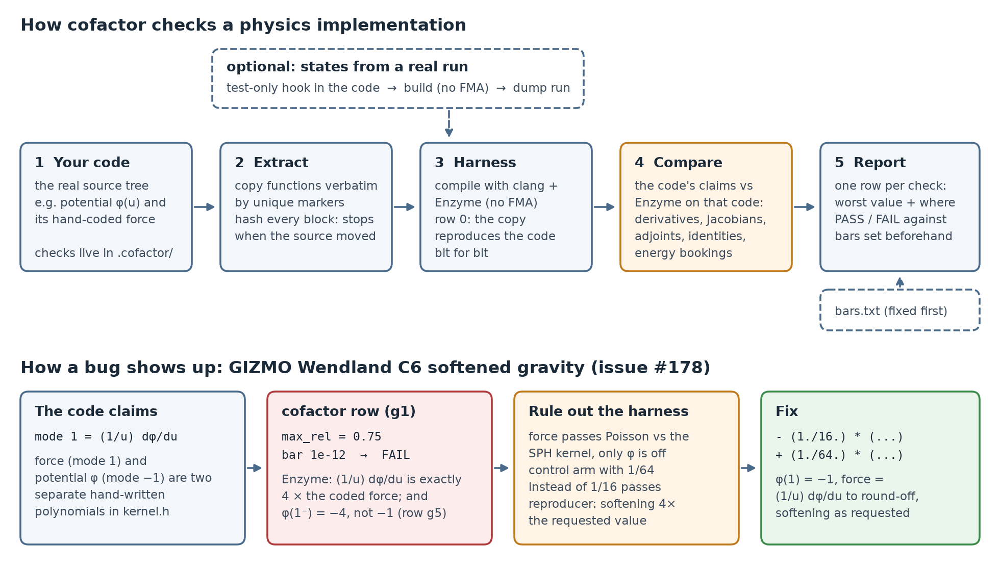

# cofactor

**cofactor is a linter for physics implementations: it checks the real code against the mathematics it is meant to
implement, using automatic differentiation.**

The intended use: you want to add a physical process to your code. You write down its equations, discretise them and
implement them. cofactor then checks directly whether the implementation is correct with respect to that discretisation:
is the force the derivative of the potential, the Jacobian of the implicit solver the derivative of its residual, the
adjoint the exact transpose of the operator, the booked energy change the change of the energy function along the code's
own rates, the flux invariant under a Galilean boost? It takes the code under test verbatim (never re-typed), runs it on
synthetic inputs or on states dumped from a real run, and compares what the code claims with
[Enzyme](https://enzyme.mit.edu) applied to the same code. Unlike a static linter it runs the code.

What it does not do: decide whether the equations describe the physics well, or how accurate the discretisation is. That
still needs physical tests and convergence studies. cofactor makes sure the code is the discretisation you wrote down.

No test problem is needed. cofactor runs the extracted functions on chosen inputs (or on states dumped from a short real
run, which only supplies inputs), not a simulation with a known answer such as a shock tube or a collapse. A direct test
tells you whether the discretised physics gives the right result; cofactor tells you whether the code is the
discretisation you meant, and it does so earlier and more precisely (which term, which line, which input), without
designing a test problem. Use both: check process A with cofactor while implementing it, then run the physical tests.

For now it is aimed at the GADGET/GIZMO/AREPO code family (GIZMO, GADGET-4, OpenGadget3, AREPO), where such pieces are
numerous and usually tested only end to end. The core is general: it works on any C/C++ code that clang compiles, and
wider coverage is possible.



Like `.clang-format` or `.clang-tidy`, a project keeps its own small setup in a `.cofactor/` directory; cofactor is the tool
that runs it.

```
my_code/
  src/...
  .cofactor/
    project.ini                 shared defaults and placeholders
    checks/
      flux_jacobian/
        target.ini              steps (build, dump, extract, harness) and configs
        spec.py                 what to copy from the source, by unique text markers
        harness.cc              calls the copied code, records check rows
        bars.txt                pass thresholds, fixed before the first run
```

## Quick start
```
export PATH=<cofactor>/bin:$PATH
cp <cofactor>/site.example.ini ~/.config/cofactor/site.ini   # machine: clang + Enzyme plugin, modules, batch system
cofactor check-env
cd <cofactor>/examples/c_cooling && cofactor run cooling     # or 'cofactor submit cooling' on a cluster
```
Expected: `clean` PASS, `planted_bug` FAIL (the example plants a wrong derivative to show it is caught).

For your code: `cofactor init` at the project root, `cofactor new <check>`, edit the four files, `cofactor run <check>`.

## What a run does
1. **build** (optional recipe): an isolated build copy, e.g. with a test-only hook that dumps raw states from a real run;
2. **dump** (optional recipe): the run that writes those states;
3. **extract**: `spec.py` copies functions/blocks verbatim. A missing or duplicated marker, an unbalanced function, or a
   block that changed since the last run stops here (exit 3) until reviewed (`--accept`);
4. **harness**: compiled with clang + Enzyme (`-ffp-contract=off`); row 0 shows the harness reproduces the code, then the
   derivative/identity rows; if Enzyme's reverse mode fails to compile, the forward-only build runs and the report says
   `REVERSE SKIPPED`;
5. **report**: every row with its worst value and where it occurred, PASS/FAIL against `bars.txt`, exclusions counted.
   Exit 0 pass, 1 fail, 2 incomplete, 3 extraction error, 4 setup error.

On clusters, compute steps can be restricted to batch jobs (`require_batch` in the site file); `cofactor submit` writes and
submits the job, which runs frozen copies of cofactor and of the check.

## Documentation
- [docs/USAGE.md](docs/USAGE.md): **how to use it**: first run, setting up a project, writing a check step by step,
  reading results, checks on states from real runs, configuration reference, troubleshooting
- [docs/INSTALL.md](docs/INSTALL.md): clang + Enzyme, site configuration, smoke test
- [docs/WRITING_A_CHECK.md](docs/WRITING_A_CHECK.md): the four files, the rules, kinds of checks, Enzyme tips
- [docs/HYDRO_CODES.md](docs/HYDRO_CODES.md): using cofactor with large hydro codes (GIZMO, AREPO, ...) and what for

## Examples
| project | check | shows |
|---|---|---|
| `examples/c_cooling` | `cooling` | the smallest complete check: plain C, synthetic inputs, a planted bug that must fail |
| `examples/gizmo` | `kernel` | real code (GIZMO's SPH kernel), every kernel shape x dimension, no build needed |
| `examples/gizmo` | `mhd_face` | a large code end to end: hook, no-FMA build, dump run, bitwise replay of the MHD face, adjoints, energy bookings, Galilean invariance |

The GIZMO setup is run against a GIZMO source tree: `cofactor run examples/gizmo/kernel -s <gizmo>`.

## Tests
cofactor's own regression tests (extractor rules, manifest, CLI, check/report library incl. NaN, missing rows, exit codes)
need no Enzyme: `bash tests/run_tests.sh`. They run on every push (GitHub Actions).

## Status
Early. Tested with clang/LLVM 18.1.8 and Enzyme `b1d93d0b` on Linux with Slurm. C/C++ code; Fortran via flang untested.

## License
BSD 3-Clause, see [LICENSE](LICENSE). Enzyme and LLVM are separate projects under their own licenses; cofactor only loads the Enzyme plugin.
